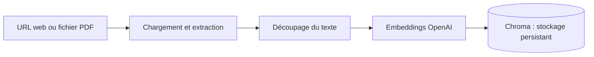
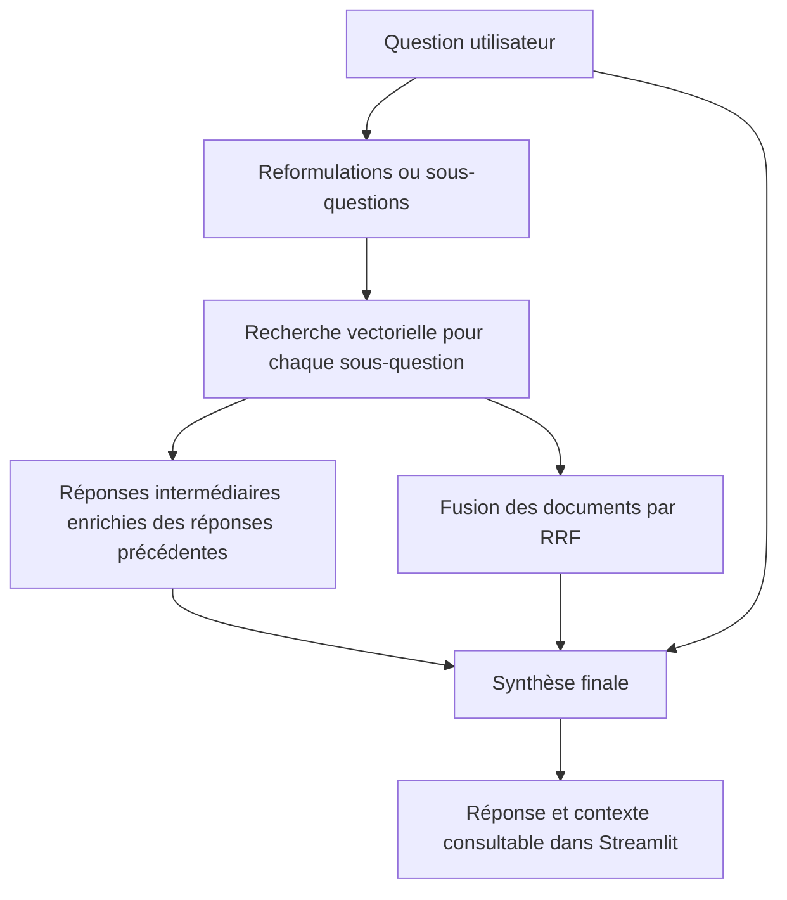

# WebRAG — Explorer des documents avec un pipeline RAG avancé

**Une application de questions-réponses sur des pages web et des PDF, combinant recherche sémantique, décomposition de questions et fusion des résultats.**

Développé en Python avec Streamlit et LangChain, WebRAG transforme une source documentaire en une base interrogeable en langage naturel. L'application récupère les passages pertinents, construit des réponses intermédiaires, puis les utilise pour produire une réponse de synthèse dont le contexte est consultable dans l'interface.

Ce projet explore un enjeu central des applications à base de LLM : **comment retrouver et assembler le bon contexte pour répondre à une question complexe ?**

[Fonctionnalités](#fonctionnalités) · [Architecture](#architecture-du-pipeline) · [Choix techniques](#choix-techniques) · [Installation](#installation) · [Évolutions](#état-actuel-et-pistes-dévolution)

## Fonctionnalités

- **Ingestion de pages web** à partir d'une URL, avec sélection de balises HTML pour cibler le contenu documentaire.
- **Import de PDF** avec extraction du texte et nettoyage du fichier temporaire après lecture.
- **Indexation vectorielle persistante** dans Chroma, avec filtrage des identifiants de fragments déjà présents.
- **Recherche multi-requêtes** : génération de 1 à 5 reformulations ou sous-questions à partir de la question initiale.
- **Réponses intermédiaires séquentielles** : chaque sous-question peut s'appuyer sur les réponses précédentes.
- **RAG Fusion** : agrégation des documents retrouvés avec l'algorithme Reciprocal Rank Fusion (RRF).
- **Consultation du contexte** : affichage des passages récupérés à côté de la réponse finale.
- **Traçage via LangSmith**, activable à partir des variables d'environnement.

## Architecture du pipeline

### 1. Préparer et indexer les données



Le texte est découpé en fragments de **300 tokens**, avec un **chevauchement de 50 tokens** pour conserver du contexte entre deux fragments. Les embeddings sont produits par `text-embedding-3-large`, puis stockés dans la collection `web_rag_collection`.

Avant l'ajout, le pipeline vérifie les identifiants construits à partir de la source et de l'index du fragment afin d'éviter de réinsérer les mêmes identifiants.

### 2. Rechercher, décomposer et synthétiser



Les chaînes sont composées avec **LangChain Expression Language (LCEL)** : templates de prompts, appels aux modèles, parseurs de sortie et fonctions personnalisées sont reliés dans un même flux de traitement.

La chaîne principale, nommée `MultiQueryRAG`, conserve à la fois la réponse finale et les documents utilisés pour permettre leur inspection dans l'interface.

## Choix techniques

| Choix | Rôle dans le projet |
| --- | --- |
| **Python & Streamlit** | Construire une interface interactive pour expérimenter le pipeline de bout en bout. |
| **LangChain & LCEL** | Composer les étapes d'ingestion, de recherche et de génération. |
| **BeautifulSoup & WebBaseLoader** | Extraire les balises `article`, `main`, `h1`, `h2` et `p` d'une page web. |
| **PyPDFLoader** | Charger le contenu textuel des PDF. |
| **Découpage avec tiktoken** | Définir la taille des fragments en tokens plutôt qu'en caractères. |
| **OpenAI Embeddings** | Représenter les fragments dans un espace vectoriel pour la recherche sémantique. |
| **Chroma** | Stocker les embeddings sur disque et rechercher les fragments pertinents. |
| **Multi-query & décomposition** | Explorer plusieurs formulations ou aspects d'une question avant la synthèse. |
| **Reciprocal Rank Fusion** | Combiner plusieurs classements en fonction du rang des documents, sans comparer directement leurs scores de similarité. |
| **LangSmith** | Observer les appels et les étapes des chaînes lorsque le traçage est configuré. |

### Pourquoi fusionner les résultats ?

Deux reformulations peuvent retrouver des passages différents mais complémentaires. Le RRF attribue à chaque document un score cumulé selon sa position dans les listes de résultats :

```text
score(document) = somme de 1 / (k + rang)
```

L'implémentation utilise `k = 60` et des rangs commençant à `0`. Les documents sont ensuite triés par score décroissant pour constituer le contexte final.

### Compétences mises en œuvre

- Conception d'un pipeline **RAG de bout en bout**, de l'ingestion à la génération.
- Mise en œuvre de stratégies de recherche avancées : **multi-query, décomposition et RAG Fusion**.
- Manipulation de documents, de métadonnées et d'une **base vectorielle persistante**.
- Orchestration d'appels LLM et transmission du contexte entre plusieurs étapes.
- Développement d'une interface interactive avec gestion d'état via `st.session_state`.
- Configuration des services externes par variables d'environnement et instrumentation des chaînes.

## Installation

### Prérequis

- Python et `pip` ; l'environnement local du projet a été créé avec **Python 3.13**.
- Une clé API OpenAI et l'accès aux modèles utilisés dans le code.
- Une clé API LangSmith : **la version actuelle de l'application vérifie sa présence au démarrage**.
- Une connexion Internet pour les appels API et le chargement des pages web.

Les modèles configurés sont `text-embedding-3-large` pour les embeddings et `gpt-5.4` pour les réponses intermédiaires et finales. La génération des reformulations utilise le modèle par défaut de `ChatOpenAI` dans la version installée de `langchain-openai`.

### 1. Cloner le dépôt et installer les dépendances

Commandes pour **PowerShell sous Windows**, à exécuter depuis le dossier où vous souhaitez cloner le projet :

```powershell
git clone https://github.com/Asfalte-dev/Langchain-web-rag.git
Set-Location Langchain-web-rag

python -m venv .venv
.\.venv\Scripts\python.exe -m pip install --upgrade pip
.\.venv\Scripts\python.exe -m pip install streamlit python-dotenv langchain-community langchain-text-splitters langchain-openai langchain-core langsmith beautifulsoup4 chromadb pypdf tiktoken
```

Le dépôt ne fournit pas encore de fichier de dépendances versionné ; cette commande liste les paquets nécessaires au code actuel, sans garantir la reproductibilité des versions.

### 2. Configurer les clés API

Copier le fichier d'exemple à la racine du projet :

```powershell
Copy-Item .env.example .env
```

Renseigner les valeurs dans `.env` :

```dotenv
OPENAI_API_KEY=votre-cle-openai
LANGCHAIN_API_KEY=votre-cle-langsmith
LANGCHAIN_ENDPOINT=https://api.smith.langchain.com
LANGCHAIN_TRACING_V2=true
```

Le fichier `.env` est exclu du suivi Git. Les embeddings et les générations utilisent l'API OpenAI et peuvent entraîner des frais selon l'usage.

### 3. Lancer l'application

Depuis la racine du dépôt :

```powershell
Set-Location apps
..\.venv\Scripts\python.exe -m streamlit run web_rag.py
```

Ouvrir l'adresse affichée par Streamlit, généralement `http://localhost:8501`.

**Le lancement depuis `apps/` est important** : le chemin de persistance est actuellement défini comme `../chroma_db`, relativement au dossier de travail. Avec ces commandes, la base est créée dans `chroma_db/` à la racine du dépôt.

## Utilisation

1. Sélectionner **Website URL** pour saisir l'adresse d'une page, ou **File upload** pour importer un PDF.
2. Cliquer sur **Initialize RAG system** ou **Initialize RAG system from file** pour indexer la source.
3. Saisir une question dans **Ask a Question**, puis cliquer sur **Get answer**.
4. Lire la réponse et déplier **Show retreived context** pour examiner les passages récupérés.

Pour explorer la décomposition, essayer une question à plusieurs dimensions sur le document chargé :

> Quels sont les principaux concepts présentés, comment sont-ils liés et quelles différences faut-il retenir ?

La base Chroma peut accumuler plusieurs sources dans la même collection. La recherche porte alors sur l'ensemble des documents indexés dans cette collection.

## Structure du dépôt

```text
Langchain-web-rag/
├── apps/
│   └── web_rag.py       # Interface Streamlit et pipeline RAG
├── chroma_db/          # Base vectorielle locale, générée à l'exécution
├── .env.example        # Exemple de configuration des services
├── .gitignore          # Exclusion des secrets et des données locales
└── README.md
```

## État actuel et pistes d'évolution

Le projet est un **prototype d'expérimentation** qui rassemble l'interface et le pipeline dans un seul script. Les stratégies sont implémentées, mais leur gain de qualité n'a pas encore été mesuré sur un jeu d'évaluation.

Les prochains axes d'amélioration identifiés dans le code sont :

- **Fiabiliser l'import TXT** : l'option est présente dans l'interface, mais utilise actuellement `Document` de `xml.dom.minidom` au lieu du type documentaire LangChain.
- **Généraliser le prompt de reformulation**, qui contient encore une référence spécifique à GregTech: New Horizons.
- **Affiner l'indexation** : retirer une duplication de la liste des documents web et faire évoluer la gestion des identifiants pour prendre en compte les modifications d'une source.
- **Recharger explicitement l'index existant au démarrage** : les données sont persistées sur disque, mais l'interface demande actuellement une initialisation pendant la session pour activer les questions.
- **Versionner les dépendances** et séparer les composants d'ingestion, de recherche et d'interface.
- **Évaluer la qualité et le coût** : comparer une recherche simple au pipeline multi-query + RRF, mesurer la latence et ajouter des citations reliant les réponses aux sources.

---

Développé par [Asfalte-dev](https://github.com/Asfalte-dev) · [Dépôt GitHub](https://github.com/Asfalte-dev/Langchain-web-rag)
